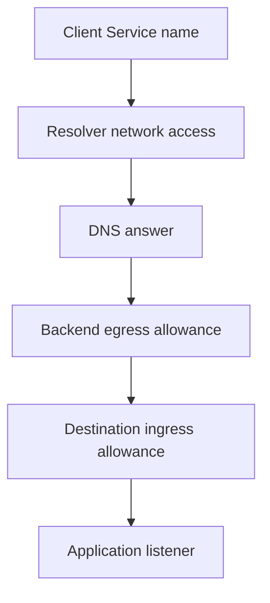

# DNS And Service Discovery

Egress isolation allows the destination Pod but blocks the resolver. The application cannot look up `probe`, so it never reaches the permitted backend connection. Dependencies include name resolution as well as the final Service.

## Learning objectives

- Explain namespace-scoped Service discovery.
- Distinguish resolver access from backend network allowance.
- Classify lookup, connection and application-response failures.

## Before you start

Use a shell on your own machine with the module playground running. A Pod is Kubernetes's unit for running one or more containers together. The environment provides the `probe` Deployment, which maintains application Pods, and the `starfleet` namespace, which groups these objects.

Read-only commands below use kubectl, the Kubernetes command-line tool. Select the private kubeconfig: the file that identifies this environment's cluster and credentials. The commands do not change the application.

## DNS and Service Discovery

The `shuttle` application contacts a backend named `probe` instead of storing an individual Pod address. The Domain Name System (DNS) resolves names to network information. Kubernetes cluster DNS publishes Service records so clients can discover stable names for application access.

A normal Service usually resolves to its virtual cluster address. Network forwarding then directs traffic to an eligible backend. A headless Service has no allocated cluster virtual address and can expose backend addresses through DNS. These patterns support different ways for clients to find endpoints.

A Service name is scoped by namespace. A short name normally uses the client's namespace search path. A namespace-qualified name identifies a Service in another namespace. The cluster DNS domain is commonly `cluster.local`, but it is configurable; a full name must use the actual cluster domain rather than assuming every cluster has the same setting.

Resolution and reachability are separate stages. A successful DNS answer proves that a name can be resolved, not that a backend is ready or that its application accepts requests. A connection can still fail because of an empty backend set, incorrect port, network policy or application problem.

Suppose `probe` works from `starfleet` but the short name fails from `outpost`. Check whether the client is asking for a Service in the wrong namespace before blaming all cluster networking. If the correct name resolves but connections fail, investigate the Service's backends and traffic path.

Discovery removes hard-coded backend addresses, but clients still need suitable connection handling. Existing connections can fail during replacement, and name or endpoint changes may require a new connection. Reliable clients retry safe operations without assuming that a previous successful lookup guarantees future health.

## Resolving Names In Different Namespaces

Assume the Service `probe` exists in `starfleet`. A client in that namespace can commonly use the short name `probe` through its configured DNS search path. A client in `outpost` using the same short name normally asks first for a Service in its own namespace, not automatically for `starfleet`'s application.

A namespace-qualified name such as `probe.starfleet` identifies the intended namespace. A full Service name also includes the Service subdomain and the configured cluster domain. That domain often uses `cluster.local`, but the client must follow the actual cluster configuration. Name shape and search behavior are configuration-dependent details, not application identities guaranteed across every cluster.

A headless Service returns backend discovery information instead of the ordinary allocated virtual address. The client may then need to choose and connect to individual endpoints itself. That can suit applications needing member identity, but it gives clients different connection responsibilities from a virtual Service access point.

## Distinguishing Four Failure Results

A name lookup failure can mean the record is absent, the namespace is wrong or the resolver cannot be reached. A resolved address with a connection refusal can indicate an absent listener or unsuitable destination. A connection timeout can indicate a blocked or unreachable path. A completed connection with an application error indicates progress beyond discovery and transport establishment.

These observations are not perfect diagnoses by themselves, but they narrow the stage. Compare the actual name queried, answer received and client context before changing cluster-wide DNS. A policy blocking DNS requests can break discovery even when the DNS service itself is healthy.

Caching adds timing. Clients and resolvers can retain answers, and an application may reuse connections after discovery. A newly correct record does not guarantee every client immediately uses the new endpoint. Reliable behavior therefore combines meaningful names, suitable cache and connection handling, and verification from the caller experiencing the failure.

## Inspect the mechanism

Domain Name System (DNS) resolution converts names into address information. In the same namespace, `probe` commonly resolves through the client's search path. In outpost, that short name first refers to outpost's scope; `probe.starfleet` identifies the intended Service namespace instead.

Egress isolation must allow the actual resolver traffic required by the client's DNS configuration. DNS commonly uses User Datagram Protocol (UDP) and can also require Transmission Control Protocol (TCP). Allowing only one protocol can leave some lookups or fallback behavior failing. Resolver labels, addresses and forwarding arrangements depend on the provisioned cluster; inspect them rather than copying a production assumption into every policy.



Allowing a backend is insufficient when the client cannot first reach the resolver needed to find it.

<!-- astrona:playground:renew -->

Select the private cluster connection and inspect the live state from your host shell:

```sh
export KUBECONFIG="$(astrona kubeconfig ats-030-playground-010-02)"
if test "$(kubectl config current-context)" = "kind-astro-ats-030-playground-010-02"; then
  kubectl -n starfleet get service probe
  kubectl -n kube-system get service kube-dns
  kubectl -n kube-system get pods -l k8s-app=kube-dns -o wide
  kubectl -n starfleet get networkpolicies -o yaml
else
  printf "Select this module's private kubeconfig before continuing.\n" >&2
fi
```

Read the actual DNS Service and resolver Pods supplied by the kind cluster. The common kube-dns name is part of this provisioned environment, not a universal requirement for every distribution. These API reads identify dependencies without performing a lookup from the client. A complete discovery test must use that client's resolver configuration and namespace.

You can now distinguish discovery dependency failure from backend connection failure. Verify each stage from the affected caller, including any DNS protocols and namespace naming rules its path requires.

## Common pitfalls

> [!WARNING]
> A DNS answer is not a health check. Short Service names depend on namespace search rules, and the cluster domain is configurable.
