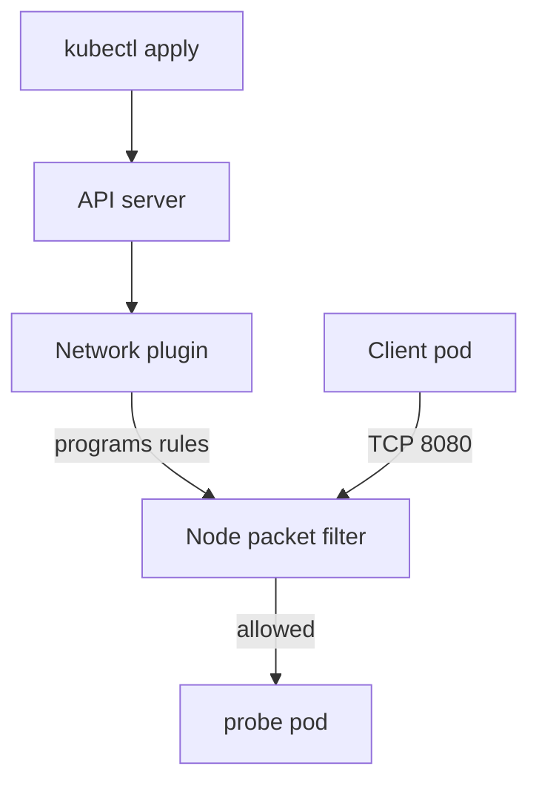

# Default Deny And Additive Policies

A Kubernetes cluster allows every pod to connect to every other pod until someone writes a NetworkPolicy. That default is convenient, but it means a compromised or misconfigured client can reach every workload. A default deny policy reverses the default for one namespace, and later policies then open only the connections the application needs. This part explains how isolation starts, how several policies combine, and which component enforces them.

## How a pod becomes isolated

A NetworkPolicy is a namespaced Kubernetes object in the API group `networking.k8s.io/v1`. It has a `podSelector` that picks the pods it applies to, a list `policyTypes` and optional `ingress` and `egress` rules. Ingress means traffic arriving at the selected pods. Egress means traffic leaving them.

A pod is not isolated by default for either direction. It becomes isolated for ingress when at least one policy selects it and lists `Ingress` in `policyTypes`. It becomes isolated for egress in the same way with `Egress`. The two directions are independent: a pod can be isolated for ingress and still open for egress.

Once a pod is isolated for a direction, the only traffic allowed in that direction is the traffic that some selecting policy lists in its rules. Nothing else gets through. This is why a policy with no rules at all is a valid and useful policy: it selects pods, isolates them and allows nothing.

The API server only stores the policy. The network plugin (the Container Network Interface plugin) watches NetworkPolicy objects and programs the rules on each node. If the plugin does not support NetworkPolicy, the object is accepted and has no effect. The kind clusters in this course use a plugin that enforces policies.

## The default deny policy

An empty `podSelector` (`{}`) matches every pod in the namespace of the policy. Combined with a `policyTypes` entry and no rules, it isolates the whole namespace for that direction.

Before the policy exists, both clients can reach the `probe` Service. Select the private kubeconfig and check:

<!-- astrona:playground:renew -->

```sh
export KUBECONFIG="$(astrona kubeconfig ats-030-playground-010-03)"
kubectl -n starfleet exec shuttle -- wget -q -T 3 -O- http://probe/
kubectl -n outpost exec drifter -- wget -q -T 3 -O- http://probe.starfleet/
```

Both commands print a line that starts with `version=v1`. The `-T 3` option makes `wget` give up after three seconds, which matters in a moment.

Save this as `default-deny-ingress.yaml`:

```yaml
apiVersion: networking.k8s.io/v1
kind: NetworkPolicy
metadata:
  name: default-deny-ingress
  namespace: starfleet
spec:
  podSelector: {}
  policyTypes:
  - Ingress
```

Apply it:

```sh
kubectl apply -f default-deny-ingress.yaml
```

Then check both clients again:

```sh
kubectl -n starfleet exec shuttle -- wget -q -T 3 -O- http://probe/
kubectl -n outpost exec drifter -- wget -q -T 3 -O- http://probe.starfleet/
```

Both commands now fail after three seconds with a timeout message from `wget`. The network plugin drops the packets silently, so the client sees no refusal, only silence. This is the signature of a NetworkPolicy block, and it differs from "connection refused", which means the pod answered that no process listens on the port.

## Policies only add allowed traffic

NetworkPolicy has no deny rule. A policy lists what is allowed, and every pod that is isolated for a direction accepts the union of the rules from all policies that select it. Order does not matter, and a later policy cannot remove what an earlier one allowed.

The next policy allows the `shuttle` pod, and only that pod, to reach `probe` on its container port. Save it as `networkpolicy-probe-from-shuttle.yaml`:

```yaml
apiVersion: networking.k8s.io/v1
kind: NetworkPolicy
metadata:
  name: probe-from-shuttle
  namespace: starfleet
spec:
  podSelector:
    matchLabels:
      app: probe
  policyTypes:
  - Ingress
  ingress:
  - from:
    - podSelector:
        matchLabels:
          app: shuttle
    ports:
    - protocol: TCP
      port: 8080
```

Apply it and test both clients:

```sh
kubectl apply -f networkpolicy-probe-from-shuttle.yaml
kubectl -n starfleet exec shuttle -- wget -q -T 3 -O- http://probe/
kubectl -n outpost exec drifter -- wget -q -T 3 -O- http://probe.starfleet/
```

The first request succeeds and the second times out. The port is 8080 because the policy applies after the Service has translated its port 80 to the container port 8080. A policy always names the port the pod listens on, not the Service port.

Both policies select the `probe` pods. The union of their rules is "nothing" from the first and "shuttle on 8080" from the second, so the result is "shuttle on 8080". Deleting `default-deny-ingress` would not stay closed: the second policy alone also isolates the `probe` pods, but the other pods of the namespace, which no policy selects, would be open again. That is the reason to keep the default deny policy.

## Default deny for egress and for both directions

Egress needs its own policy. A policy with `policyTypes: [Egress]` and no `egress` rules stops every pod of the namespace from opening any connection, including connections to the cluster DNS (Domain Name System) service, which resolves names such as `probe.starfleet`. A policy with both `Ingress` and `Egress` and no rules closes both directions.

```yaml
apiVersion: networking.k8s.io/v1
kind: NetworkPolicy
metadata:
  name: default-deny-all
  namespace: starfleet
spec:
  podSelector: {}
  policyTypes:
  - Ingress
  - Egress
```

Both ends of a connection must allow it. The source pod's egress must allow the connection, and the destination pod's ingress must allow it. Replies to an allowed connection travel back without a rule, because the plugin tracks the connection. When you add a default deny for egress, you must therefore also allow DNS, or no name resolves.

The opposite policies exist as well. A rule list with one empty element, such as `ingress: [{}]`, allows all traffic for the selected pods. Authors use it to state "open" on purpose.

## Which component does what

The `kubectl apply` command only sends the object to the API server. The network plugin on each node turns the policy into packet filtering rules. The `kubelet` is not involved, and a policy does not block the kubelet's own health probes to the pod.



The diagram shows that the API server stores the policy and the network plugin enforces it on the node that receives the traffic.

## What you know now

A pod is isolated per direction once any policy selects it for that direction. A default deny policy uses an empty `podSelector` and no rules. Policies only add allowed traffic, and both ends of a connection must allow it. The open question is how to name the allowed peers precisely, and that is the next topic.

## Common pitfalls

> [!WARNING]
> A default deny policy for egress also blocks DNS, so every name lookup fails until DNS is allowed. A policy cannot deny a connection that another policy allows. Test a block with a short timeout, and read a timeout as a policy block and "connection refused" as a pod that does not listen.
