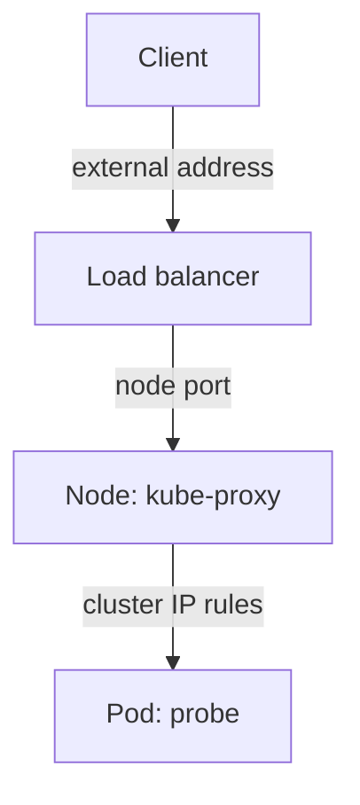

# Service Types: ClusterIP, NodePort And LoadBalancer

Pods are created and deleted all the time, and each new pod gets a new IP address. A client cannot follow that. A Service is a Kubernetes object that has one stable virtual address and a selector, and the cluster forwards requests sent to that address to the ready pods that match the selector. The `type` field of the Service decides who can reach the virtual address: only pods inside the cluster, clients that can reach a node, or clients that can reach an external load balancer.

## ClusterIP, the default

When `type` is omitted, the Service is of type `ClusterIP`. The API server allocates a cluster IP from the Service address range of the cluster, and that address answers only inside the cluster. The `kube-proxy` component runs on every node. It watches Services and EndpointSlices and programs the node's packet rules so that a connection to the cluster IP and port is rewritten to the address of one ready pod and the `targetPort`. No process listens on the cluster IP itself.

Select the private kubeconfig of the playground and look at the Service that already exists:

<!-- astrona:playground:renew -->

```sh
export KUBECONFIG="$(astrona kubeconfig ats-030-playground-020-03)"
kubectl -n starfleet get service probe
kubectl -n starfleet get endpointslices -l kubernetes.io/service-name=probe
```

The first command shows the type `ClusterIP`, the cluster IP and the port `80/TCP`. The second shows the EndpointSlice that the EndpointSlice controller keeps in sync with the ready pods. An EndpointSlice is an object that lists the addresses and ports of the pods behind a Service.

## Creating a Service with kubectl

Writing YAML is not the only way. The command `kubectl expose` creates a Service from an existing workload and reuses the selector of the workload. The `--port` option sets the Service port and `--target-port` sets the container port. This is the fast form for the exam.

```sh
kubectl -n starfleet expose deployment probe --name=probe-nodeport --type=NodePort --port=80 --target-port=8080
kubectl -n starfleet get service probe-nodeport
```

The output shows `80:` followed by a number from 30000 to 32767, for example `80:31234/TCP`. Your number differs, because the API server picks a free node port when you do not set one.

## NodePort

A `NodePort` Service is a `ClusterIP` Service with one more feature: `kube-proxy` opens the same port, the node port, on every node and forwards connections to it to the Service. The default node port range is 30000 to 32767. You can set the number with the `nodePort` field, and the API server rejects a number that is outside the range or in use.

Save this as `service-probe-fixed-port.yaml`. It uses a fixed node port so the number is known:

```yaml
apiVersion: v1
kind: Service
metadata:
  name: probe-fixed
  namespace: starfleet
spec:
  type: NodePort
  selector:
    app: probe
    release: probe
  ports:
  - name: http
    port: 80
    targetPort: 8080
    nodePort: 30080
```

Apply it:

```sh
kubectl apply -f service-probe-fixed-port.yaml
```

Then reach it from the `shuttle` pod through the address of the node. A kind node is a container, and its address is visible to the pods of the cluster:

```sh
NODE_IP="$(kubectl get nodes -o jsonpath='{.items[0].status.addresses[?(@.type=="InternalIP")].address}')"
kubectl -n starfleet exec shuttle -- wget -q -T 3 -O- "http://${NODE_IP}:30080/"
```

The reply starts with `version=v1`. Outside a lab, a developer sends the same request from a machine that can reach the node address. A NodePort exposes the Service on every node, so firewalls must allow the port, and the port number is not a nice public interface.

## LoadBalancer

A `LoadBalancer` Service is a `NodePort` Service plus a request to the environment for an external load balancer. A component named the cloud controller manager, or an add-on such as MetalLB on bare metal, creates the load balancer and writes its address into the field `status.loadBalancer.ingress`. The `EXTERNAL-IP` column of `kubectl get service` shows that address.

A kind cluster has no such component. Create a `LoadBalancer` Service to see what that looks like:

```sh
kubectl -n starfleet expose deployment probe --name=probe-lb --type=LoadBalancer --port=80 --target-port=8080
kubectl -n starfleet get service probe-lb
```

The `EXTERNAL-IP` column shows `<pending>` and stays so, because no component fulfils the request. The Service still works as a `NodePort` Service, because the type includes one. `<pending>` is therefore a statement about the environment, not about the application.



The diagram shows that a `LoadBalancer` Service reuses the node port and the cluster IP rules, and that only the first hop is added.

## Choosing a type

Use `ClusterIP` for traffic between workloads. Use `NodePort` when you must reach the application from outside and have no load balancer, for example in a test cluster. Use `LoadBalancer` where the environment can create one. For HTTP, an Ingress usually replaces the second and third types, because one controller serves many hosts and paths.

## Session affinity

By default each new connection goes to any ready pod. The field `sessionAffinity: ClientIP` sends all connections from one client address to the same pod for a timeout (10800 seconds by default, set in `sessionAffinityConfig.clientIP.timeoutSeconds`). The setting does not guarantee balance and does not apply to clients behind one shared address.

## What you know now

The type controls who can reach the Service, and `kube-proxy` does the forwarding in all three cases. A node port or a pending load balancer tells you about exposure, and the selector and ready pods still decide the backends. The next question is how clients find a Service by name, and what a Service without a cluster IP does.

## Common pitfalls

> [!WARNING]
> A node port outside 30000-32767 is rejected. `EXTERNAL-IP <pending>` in kind is expected. `kubectl expose` copies the selector of the workload, so exposing a Deployment with a changed label gives an empty Service. Clients use the Service `port`, not the `nodePort`, inside the cluster.
